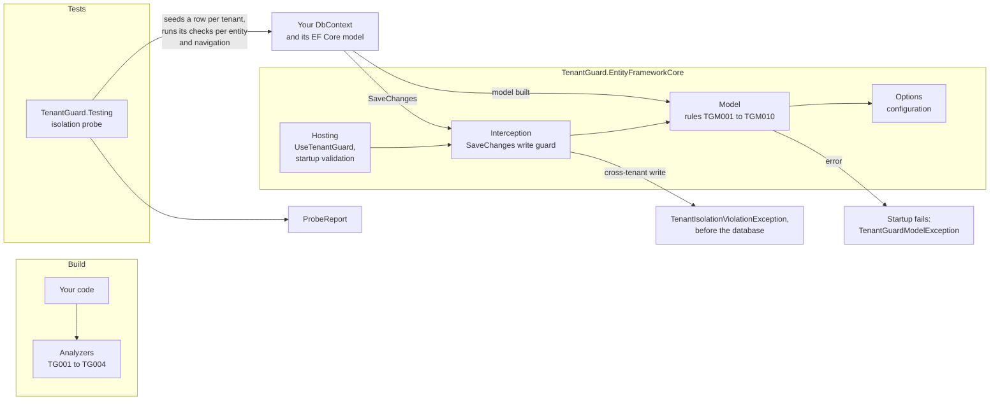

<h1>
  <picture>
    <source media="(prefers-color-scheme: dark)" srcset="docs/assets/logo-dark.svg">
    
  </picture>
</h1>

> **Preview.** The 0.1.0 previews build their net11.0 target against the EF Core 11
> release candidate, so they are prereleases on NuGet. The stable v0.1.0 follows .NET 11
> and EF Core 11 general availability.

Multi-tenant EF Core apps isolate tenants with global query filters and a `TenantId`
column. A dozen packages ship that mechanism (Finbuckle.MultiTenant, TenancyKit,
SaasSuite, Tenantry, MultiTenancy.EntityFrameworkCore, and more), and most teams hand-roll
it. None of them ship the proof. One forgotten `HasQueryFilter`, one `IgnoreQueryFilters()`
in a report, one `ExecuteSqlRaw` without a `WHERE TenantId`, or one filter that captured a
local variable at model build, and tenant A reads tenant B.

TenantGuard is the proof. It does not resolve tenants and does not add filters. It takes
the model you already have and:

- fails startup when an entity with a tenant property has no query filter on it, or when
  the filter is frozen to a value;
- rejects a `SaveChanges` that writes, moves or deletes another tenant's row;
- flags `IgnoreQueryFilters()` and raw SQL without a tenant predicate at compile time,
  unless the method carries a justification;
- proves isolation per entity in a test, so a new entity cannot ship unguarded.

In an audit of a SaaS codebase, every entity had a `TenantId` and every reviewer assumed
every entity had a filter. One did not. Nothing in the build or the tests could have said
so.

It works on Finbuckle, on any of the tenancy packages, and on hand-rolled query filters.

[](https://www.nuget.org/packages/TenantGuard.EntityFrameworkCore) [](https://github.com/jimmykurian/tenantguard/releases) [](LICENSE)

[Documentation](https://jimmykurian.github.io/tenantguard/) · [Rules](https://jimmykurian.github.io/tenantguard/reference/rules/) · [Analyzers](https://jimmykurian.github.io/tenantguard/reference/analyzers/) · [Guides](https://jimmykurian.github.io/tenantguard/guides/) · [Changelog](CHANGELOG.md) · [NuGet](https://www.nuget.org/packages/TenantGuard.EntityFrameworkCore)


## Packages

| Package | Targets | Contents |
|---|---|---|
| `TenantGuard.EntityFrameworkCore` | net10.0, net11.0 | Model validation, SaveChanges guard, bypass scope; bundles the analyzers |
| `TenantGuard.Analyzers` | netstandard2.0 | The analyzers on their own, for projects without EF Core |
| `TenantGuard.Testing` | net10.0, net11.0 | `TenantIsolationProbe`, seeding, `ProbeReport` |
| `TenantGuard.Tool` | net10.0, net11.0 | `dotnet tenantguard validate`: the model rules in CI, without a database |

The net10.0 build runs on EF Core 10, the net11.0 build on EF Core 11. The only
dependency is `Microsoft.EntityFrameworkCore`, so it works with any provider.

## Install

```sh
dotnet add package TenantGuard.EntityFrameworkCore --prerelease
dotnet add package TenantGuard.Testing --prerelease   # in the test project
```

## Quick start

```csharp
builder.Services.AddDbContext<AppDbContext>(options => options
    .UseSqlServer(connectionString)
    .UseTenantGuard(tg => tg
        .CurrentTenant(context => ((AppDbContext)context).TenantId)));
builder.Services.AddTenantGuardStartupValidation<AppDbContext>();
```

From then on:

- The host fails to start when the model breaks a rule, with every error in one
  `TenantGuardModelException`.
- `SaveChanges` throws `TenantIsolationViolationException`, before anything reaches the
  database, when it would write, move or delete a row of a tenant other than the
  context's current one.
- The build warns on each `IgnoreQueryFilters()` and each raw SQL statement that doesn't
  mention `TenantId`.

`CurrentTenant` returns the tenant the context runs as, of the tenant property's type. The
[hand-rolled](https://github.com/jimmykurian/tenantguard/blob/main/docs/guides/hand-rolled.md)
and [Finbuckle](https://github.com/jimmykurian/tenantguard/blob/main/docs/guides/finbuckle.md)
guides show it for each setup.

## Rules

Checked when EF Core builds the model. An entity type is tenant-scoped when it has a
tenant property: one named `TenantId` (or as configured), one marked `[TenantKey]`, or
Finbuckle's.

| ID | Severity | Reported when |
|---|---|---|
| TGM001 | error | A tenant-scoped entity type has no query filter that reads its tenant property |
| TGM002 | error, opt-in | An entity type has no tenant property and isn't declared shared (`RequireAllEntitiesScoped`) |
| TGM003 | error | The tenant filter reads a local value captured when the model was built |
| TGM004 | error | The tenant filter compares the tenant property with a constant |
| TGM005 | warning | The tenant property is nullable |
| TGM006 | error | A derived type declares the tenant property; filters live on the root |
| TGM007 | warning | TenantGuard can't tell where the filter's tenant value comes from |
| TGM008 | warning | An owned type has its own tenant property, which is ignored |
| TGM009 | warning | No index or key starts with the tenant property, so filtered queries scan every tenant's rows |
| TGM010 | error | A unique index or alternate key leaves out the tenant property, so it's unique across tenants |

[Rules reference](https://github.com/jimmykurian/tenantguard/blob/main/docs/reference/rules.md)

## Analyzers

| ID | Severity | Reported when |
|---|---|---|
| TG001 | warning | `IgnoreQueryFilters()` switches the tenant filter off |
| TG002 | warning | Raw SQL doesn't mention the tenant column |
| TG003 | error | `[AllowCrossTenantAccess]` has no reason |
| TG004 | info | Raw SQL is built at runtime, so it can't be checked |

Code that crosses tenants on purpose says why, and the analyzers leave it alone:

```csharp
[AllowCrossTenantAccess("billing totals for every tenant, run by the nightly job")]
public Task<decimal> TotalForAllTenantsAsync(AppDbContext db)
    => db.Invoices.IgnoreQueryFilters().SumAsync(invoice => invoice.Total);
```

Two `.editorconfig` keys tune them: `tenantguard.tenant_column` (default `TenantId`) and
`tenantguard.tenant_filter_names`.
[Analyzers reference](https://github.com/jimmykurian/tenantguard/blob/main/docs/reference/analyzers.md)

## Testing

```csharp
var report = await new TenantIsolationProbe<AppDbContext>(tenant => CreateContext(tenant))
    .WithTenants("acme", "globex")
    .RunAsync();

report.AssertAllPassed();
```

For every tenant-scoped entity type, the probe seeds a row per tenant, then checks that
one tenant can't read, find, bulk-delete, update, insert over or delete another's. A
failure lists what leaked:

```text
TenantGuard isolation probe: 3 of 12 checks did not pass.

Entity    Check          Outcome  Detail
--------  -------------  -------  ------
Customer  ReadIsolation  Failed   As acme, Set<Customer>() returned globex's row (Id: 2). ...
Customer  FindIsolation  Failed   As acme, FindAsync(Id: 2) returned globex's row. ...
Customer  BulkIsolation  Failed   As acme, ExecuteDelete removed globex's row (Id: 2). ...
```

It runs under xUnit, NUnit, MSTest and TUnit alike.
[Testing guide](https://github.com/jimmykurian/tenantguard/blob/main/docs/guides/testing.md)

## Adopting it in a running app

1. Install, and fix or justify what the analyzers report.
2. Turn on the model rules with `.Enforcement(Enforcement.Log)`: errors are logged, not
   thrown, so nothing stops while you fix them.
3. Run your tests with the write guard on, and wrap the writes that cross tenants on
   purpose in `context.TenantGuard().Bypass("why")`.
4. Drop `Enforcement.Log` (`Throw` is the default) and add
   `AddTenantGuardStartupValidation`.
5. Add a probe test to CI.

[Migration guide](https://github.com/jimmykurian/tenantguard/blob/main/docs/guides/migrating.md)

## How it compares

| Tool | What it does | What it leaves to TenantGuard |
|---|---|---|
| Finbuckle.MultiTenant and the other tenancy packages | Resolve the tenant; add the filter and the tenant property | Proving the filter is on every entity and that queries and writes keep to it. TenantGuard runs on top of them. |
| Finbuckle's `[MultiTenant]` and `IsMultiTenant()` | Configure an entity as multi-tenant | Verifying it: they are configuration, not verification |
| EricksonLopez.MultiTenancy.Analyzers | Roslyn rules on that author's `ITenantContext` lifetimes and Dapper helpers | Anything about EF Core query filters |
| ArchUnitNET, NetArchTest | Structural rules on types and dependencies | Anything that needs the EF Core model |

## FAQ

**Does TenantGuard resolve the tenant, or add the filters?** No. It checks the filters you
have, however they got there: written by hand, or added by a tenancy package.

**Does it slow queries down?** No. Queries run as they did. The rules run once, when EF
Core builds the model, and on `SaveChanges` the guard looks only at the tracked entries.

**What about `ExecuteUpdate` and `ExecuteDelete`?** They don't go through `SaveChanges`, so
the write guard doesn't see them. The query filter scopes them, the probe's BulkIsolation
check proves it for each entity, and TG001 flags an `IgnoreQueryFilters()` that would
switch the filter off first.

**And raw SQL?** TG002 and TG004 flag it at build time, through EF Core, Dapper, ADO.NET
commands and any wrapper you list in `tenantguard.raw_sql_methods`. `FromSql` on an entity
type isn't flagged: EF Core applies the query filters over it.

**Named query filters?** Supported. A named filter that reads the tenant property counts
for TGM001, and with `tenantguard.tenant_filter_names` set, TG001 lets
`IgnoreQueryFilters(["SoftDelete"])` through while the tenant filter stays on.

**DbContext pooling?** Supported. A context goes back to the pool with the guard on, even
if a bypass scope was never disposed.

**What doesn't it check yet?** Owned entities: the write guard skips their entries, so a
save that changes only the owned part of another tenant's row isn't blocked. The raw SQL
check looks for the column's name in the SQL text; it doesn't parse SQL.

## Documentation

The full documentation is at **<https://jimmykurian.github.io/tenantguard/>**, with search. It's built from
[`docs/`](docs/README.md) by [`site/`](site/), so every page also reads here on GitHub.

| | |
| --- | --- |
| [Guides](docs/guides/README.md) | [Why TenantGuard](docs/guides/why.md), [hand-rolled filters](docs/guides/hand-rolled.md), [Finbuckle](docs/guides/finbuckle.md), [testing with the probe](docs/guides/testing.md) and [migrating an existing app](docs/guides/migrating.md) |
| [Reference](docs/reference/README.md) | [Rules](docs/reference/rules.md) TGM001 to TGM010, [analyzers](docs/reference/analyzers.md) TG001 to TG004, the [write guard](docs/reference/write-guard.md), the [isolation probe](docs/reference/probe.md), [options](docs/reference/options.md), [exceptions](docs/reference/exceptions.md) and [logging](docs/reference/logging.md), with every message, and what stays [compatible](docs/reference/compatibility.md) |
| [Architecture](docs/architecture/README.md) | The [packages](docs/architecture/packages.md), the [flows](docs/architecture/flows.md), and the [decision records](docs/architecture/decisions/README.md) behind them |
| [Testing strategy](docs/testing/strategy.md) | How TenantGuard tests itself, and the EF Core behaviors it pins |
| [Releases and CI](docs/deployment/releases-and-ci.md) | The workflows and how a release ships |
| [Roadmap](https://github.com/users/jimmykurian/projects/2) | What's planned next, by milestone |
| [Samples](samples/) | A hand-rolled app and a Finbuckle app, each with a probe test in [`tests/e2e`](tests/e2e/) |
| [Changelog](CHANGELOG.md) | Every release |

## Architecture

TenantGuard reads the model your app already builds and never changes it. Three packages
work at three moments: the analyzers at build, the runtime package when EF Core builds the
model and on every `SaveChanges`, and the test kit in your tests.



Inside the runtime package the folders are rings, and each depends only on the rings
further in; the architecture tests in [`tests/architecture`](tests/architecture/) fail on
a dependency that points outward. [ADR 0019](docs/architecture/decisions/0019-runtime-folders-are-rings.md) records why.

## Development

Requires the .NET 11 SDK (11.0.100-rc.3 or later) and [Task](https://taskfile.dev). Every
command runs through the [Taskfile](Taskfile.yml), and CI calls the same tasks: `task ci`
runs lint, build, the unit, architecture, integration and end-to-end tests, pack, the
samples and scrub. `task --list` shows the rest. The docs site needs Node.js 22 or later
and pnpm: `task site:install`, then `task site:dev` serves it with live reload.

Commits follow [Conventional Commits](https://conventionalcommits.org).
`git config commit.template .gitmessage` loads a template with the types and scopes.
`task hooks:install` turns on the git hooks in `.githooks/`: pre-commit refuses commits on
`main` and checks the staged files, commit-msg checks the message, and pre-push runs
`task lint` and `task test` before code reaches GitHub.

[CONTRIBUTING.md](CONTRIBUTING.md) covers the tasks, the tests, the hooks and how to send a
change. Report a vulnerability through [SECURITY.md](SECURITY.md), not an issue.
[ACCESSIBILITY.md](ACCESSIBILITY.md) says how messages, output and docs stay readable with
assistive technology, and lists the known gaps.

## Status

Each badge is a check from the last CI run on `main`: `.github/workflows/ci.yml` writes
them to the `badges` branch. On a pull request, the same checks run as the pull request's
checks.

### Checks

| Branch | Format | Public API | License headers | LightBDD scenarios | Code metrics | Scrub | ci-parity |
| --- | --- | --- | --- | --- | --- | --- | --- |
| main | [](https://github.com/jimmykurian/tenantguard/actions/workflows/ci.yml?query=branch%3Amain) | [](https://github.com/jimmykurian/tenantguard/actions/workflows/ci.yml?query=branch%3Amain) | [](https://github.com/jimmykurian/tenantguard/actions/workflows/ci.yml?query=branch%3Amain) | [](https://github.com/jimmykurian/tenantguard/actions/workflows/ci.yml?query=branch%3Amain) | [](https://github.com/jimmykurian/tenantguard/actions/workflows/ci.yml?query=branch%3Amain) | [](https://github.com/jimmykurian/tenantguard/actions/workflows/ci.yml?query=branch%3Amain) | [](https://github.com/jimmykurian/tenantguard/actions/workflows/ci.yml?query=branch%3Amain) |

### Build and tests

| Branch | Build | Unit tests | Architecture tests | Integration tests | End-to-end tests | Samples | Pack | Docs site |
| --- | --- | --- | --- | --- | --- | --- | --- | --- |
| main | [](https://github.com/jimmykurian/tenantguard/actions/workflows/ci.yml?query=branch%3Amain) | [](https://github.com/jimmykurian/tenantguard/actions/workflows/ci.yml?query=branch%3Amain) | [](https://github.com/jimmykurian/tenantguard/actions/workflows/ci.yml?query=branch%3Amain) | [](https://github.com/jimmykurian/tenantguard/actions/workflows/ci.yml?query=branch%3Amain) | [](https://github.com/jimmykurian/tenantguard/actions/workflows/ci.yml?query=branch%3Amain) | [](https://github.com/jimmykurian/tenantguard/actions/workflows/ci.yml?query=branch%3Amain) | [](https://github.com/jimmykurian/tenantguard/actions/workflows/ci.yml?query=branch%3Amain) | [](https://github.com/jimmykurian/tenantguard/actions/workflows/ci.yml?query=branch%3Amain) |

### Workflows

| Branch | SQL Server and PostgreSQL | Release | Docs site deploy |
| --- | --- | --- | --- |
| main | [](https://github.com/jimmykurian/tenantguard/actions/workflows/providers.yml?query=branch%3Amain) | [](https://github.com/jimmykurian/tenantguard/actions/workflows/release.yml?query=branch%3Amain) | [](https://github.com/jimmykurian/tenantguard/actions/workflows/site.yml?query=branch%3Amain) |

## Code metrics

The size and complexity of the C# code: files and lines of code without blanks or
comments, and the cyclomatic complexity of every method, read with Roslyn's syntax API by
[`tools/Metrics`](tools/Metrics/). `task metrics:readme` writes them here, and CI and the
pre-push hook fail while they're out of date, so each change updates them. Run
`task metrics` to see them locally.

<!-- METRICS:START -->

| Metric | Packages | Tests | Samples | Total |
| --- | --- | --- | --- | --- |
| Files | 78 | 79 | 14 | 171 |
| Lines of code | 3,442 | 4,761 | 228 | 8,431 |
| Methods | 260 | 509 | 21 | 790 |
| Average complexity | 3.2 | 1.1 | 1.2 | 1.8 |
| Max complexity | 25 | 4 | 4 | 25 |

<details>
<summary>The 10 most complex methods</summary>

| Method | Where | Complexity |
| --- | --- | --- |
| `TenantWriteGuard.Check` | `src/TenantGuard.EntityFrameworkCore/Interception/TenantWriteGuard.cs:15` | 25 |
| `CommandLine.Parse` | `src/TenantGuard.Tool/CommandLine.cs:41` | 22 |
| `ValueGenerator.Create` | `src/TenantGuard.Testing/Seeding/ValueGenerator.cs:38` | 20 |
| `ProbeRun.RunAsync` | `src/TenantGuard.Testing/Probe/ProbeRun.cs:28` | 15 |
| `NavigationCase.For` | `src/TenantGuard.Testing/Probe/NavigationCase.cs:25` | 13 |
| `RowFactory.Add` | `src/TenantGuard.Testing/Seeding/RowFactory.cs:58` | 13 |
| `TenantModelRules.CheckRoot` | `src/TenantGuard.EntityFrameworkCore/Model/TenantModelRules.cs:40` | 12 |
| `SeedPlan.Create` | `src/TenantGuard.Testing/Seeding/SeedPlan.cs:33` | 12 |
| `Validation.Run` | `src/TenantGuard.Tool.Payload/Validation.cs:27` | 12 |
| `ValidateCommand.Run` | `src/TenantGuard.Tool/ValidateCommand.cs:25` | 12 |

</details>

<!-- METRICS:END -->
