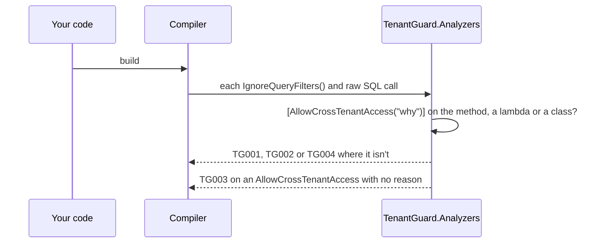

# Flows

What TenantGuard does at each of the four moments it runs: when the code compiles, when EF
Core builds the model, on every `SaveChanges`, and when the isolation probe runs in a test.

## At build: the analyzers

The analyzers run inside the compiler, on every build and in the IDE. They read the syntax
and the semantic model, never the EF Core model, so they work without a database or a
running app.



[Analyzers](../reference/analyzers.md) has each rule's trigger and message.

## When the model is built: the rules

`UseTenantGuard` adds an `IDbContextOptionsExtension` that registers an
`IConventionSetPlugin` with one `IModelFinalizedConvention`
([0003](decisions/0003-model-validation-as-an-ef-convention.md)). When EF Core finalizes the
model, the convention finds each entity type's tenant property, runs TGM001 to TGM008,
stores the per-entity metadata as a model annotation (`TenantGuard:Entities`), and throws or
logs per `Enforcement`. EF Core caches the model per context type, so the rules run once.

EF Core builds the model lazily, on the context's first use. `AddTenantGuardStartupValidation`
makes that happen at startup: its check runs through `ValidateOnStart`, before any hosted
service, resolves the context in a scope (or creates one from `IDbContextFactory<TContext>`)
and touches `.Model` ([0009](decisions/0009-startup-validation-through-validateonstart.md)).

```mermaid
sequenceDiagram
    participant Host as Generic host
    participant Check as Startup check
    participant EF as EF Core
    participant Rules as TenantGuard convention
    Host->>Check: ValidateOnStart, before any hosted service
    Check->>EF: resolve the context, read .Model
    EF->>Rules: model finalized
    Rules->>Rules: discover tenant properties, run TGM001 to TGM008
    Rules->>EF: store TenantGuard:Entities on the model
    alt an error, Enforcement.Throw
        Rules-->>Host: TenantGuardModelException with every error; the host fails to start
    else Enforcement.Log, or warnings only
        Rules-->>Host: findings logged; the host starts
    end
```

`TenantGuardModel.Validate(model, options)` runs the same rules on any model without a
context, for unit tests and tooling. [Rules](../reference/rules.md) has each rule, and
[Options](../reference/options.md) the registration.

## On SaveChanges: the write guard

The interceptor implements both `SavingChanges` and `SavingChangesAsync`. It reads the
metadata the convention stored, checks each tenant-scoped entry against the current tenant,
and throws before anything reaches the database.

```mermaid
sequenceDiagram
    participant App as Your code
    participant EF as EF Core
    participant Guard as Write guard
    participant DB as Database
    App->>EF: SaveChanges
    EF->>Guard: SavingChanges
    alt bypass open, nothing tracked, or no tenant-scoped type
        Guard-->>EF: continue, no allocations
    else
        Guard->>Guard: CurrentTenant(context); check each Added, Modified and Deleted entry
        alt a write outside the current tenant
            Guard-->>App: TenantIsolationViolationException
        else every write in the current tenant
            Guard-->>EF: continue (stamping new rows first under StampOnAdd)
            EF->>DB: the writes
        end
    end
```

[The write guard](../reference/write-guard.md) has the check for each state.

## In a test: the isolation probe

The probe seeds a row per tenant for every tenant-scoped entity type, through each tenant's
own context, then runs six checks for every ordered pair of tenants.

```mermaid
sequenceDiagram
    participant Test as Your test
    participant Probe as TenantIsolationProbe
    participant Ctx as Context per tenant
    Test->>Probe: RunAsync
    Probe->>Ctx: read the model (rule errors fail here, before seeding)
    Probe->>Ctx: seed one row per tenant per entity type, principals first
    loop every entity type, every ordered pair of tenants
        Probe->>Ctx: ReadIsolation, FindIsolation (before any check writes)
        Probe->>Ctx: BulkIsolation, UpdateGuard, InsertGuard, DeleteGuard, each rolled back
    end
    Probe-->>Test: ProbeReport; AssertAllPassed throws a table of what leaked
```

[The isolation probe](../reference/probe.md) has the seeding rules and each check.
