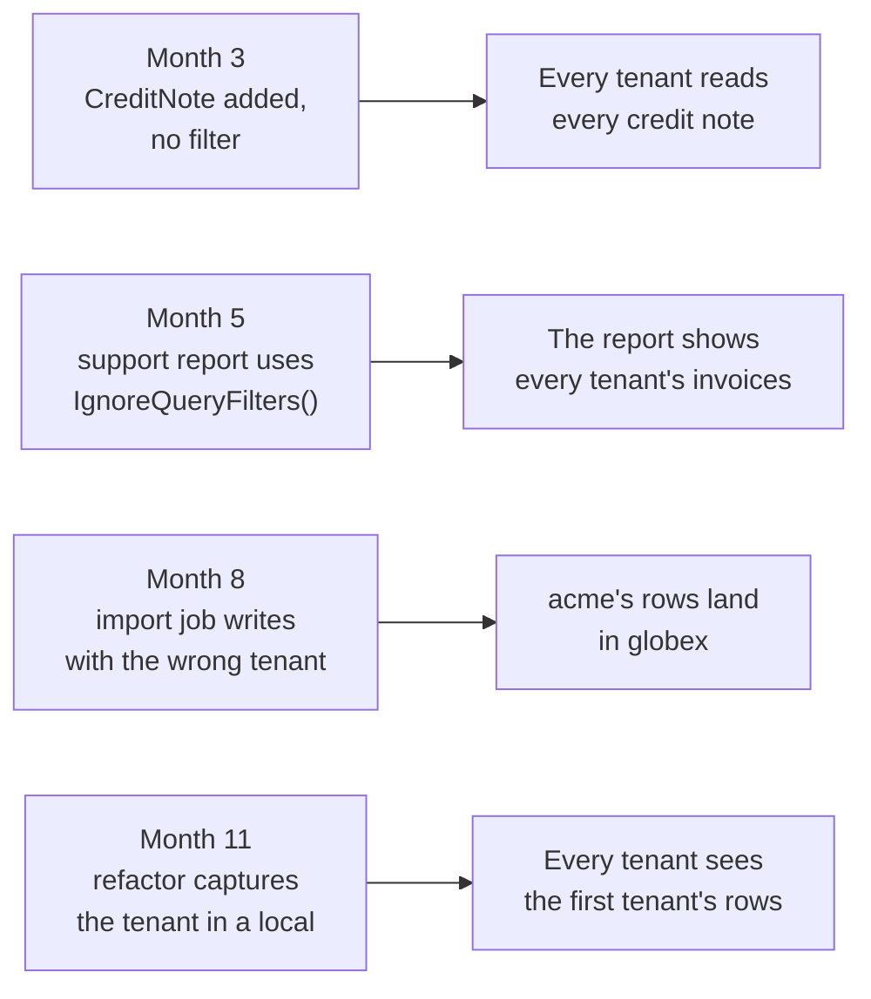

# A use case: one invoicing app, four leaks

A story about a multi-tenant SaaS app: how tenant data leaks in a codebase where everyone
did the right thing on day one, and where TenantGuard catches each leak. The app and its
tenants are made up; the mistakes are the common ones.

## The app

An invoicing service built on ASP.NET Core and EF Core, with every tenant's data in one
database. Each tenant-scoped table has a `TenantId` column, and the `DbContext` adds a
query filter to each entity:

```csharp
modelBuilder.Entity<Invoice>().HasQueryFilter(invoice => invoice.TenantId == TenantId);
```

`acme` and `globex` are two of its customers. On day one, every entity has its filter,
every query is scoped, and every review checks for it. Then the team ships for a year.

## Four ordinary changes, four leaks



1. **Month 3: a new entity with no filter.** A developer adds `CreditNote` with a
   `TenantId` column, copies the configuration from another entity, and misses the
   `HasQueryFilter`. Every query on credit notes now returns every tenant's rows. The
   tests pass: they seed one tenant.
2. **Month 5: a report that switches the filter off.** Support needs a page that finds a
   customer's invoice by number across tenants, and someone adds `IgnoreQueryFilters()`.
   It's reused by a tenant-facing export a sprint later.
3. **Month 8: a write into another tenant.** A background import job uses one context for
   a batch and sets `TenantId` from a field that's sometimes stale. Some of acme's
   invoices are saved as globex's. Query filters only scope reads, so nothing stops it.
4. **Month 11: a filter frozen to one tenant.** A refactor moves the filter into an
   `IEntityTypeConfiguration` class and reads the tenant into a local first. EF Core caches
   the model per context type, so the first tenant's id is baked into it: every tenant
   after the first reads the first tenant's rows.

None of these fail the build or the tests. Each is found by a customer.

## Where TenantGuard catches each one

| Change | At build (analyzers) | At startup (model rules) | On SaveChanges (write guard) | In tests (isolation probe) |
| --- | --- | --- | --- | --- |
| `CreditNote` has no filter | | **TGM001** fails the host | | Fails too: the probe reads the model first, so the rule error stops it before seeding |
| `IgnoreQueryFilters()` in a report | **TG001** warns, unless the method says why with `[AllowCrossTenantAccess]` | | | |
| The import job writes acme's rows as globex's | | | **`TenantIsolationViolationException`**, before anything reaches the database | **InsertGuard** and **UpdateGuard** prove the guard is on |
| The filter captures the tenant in a local | | **TGM003** fails the host | | Fails too, on the rule error |

With TenantGuard in place, the first and last changes can't start, the report is flagged
in the pull request that adds it, and the import job fails loudly on its first bad batch,
with the entity, its key and both tenants in the message, and no other entity value.

## Who it's for

- Apps where tenants share a database and a schema, and EF Core query filters do the
  isolating: hand-rolled, or added by Finbuckle.MultiTenant or another tenancy package.
- Codebases that more than a few people change: the leaks above come from ordinary changes
  by people who didn't write the original filters.
- Teams that need to show that isolation holds: the probe is a test that proves it, entity
  by entity, on every build.

## When you don't need it

- Each tenant has its own database or schema, chosen per request: query filters aren't
  what isolates tenants there.
- Most data access goes through Dapper or plain ADO.NET: the analyzers check that SQL
  for a tenant column, but query filters, the write guard and the probe only cover EF Core.
- The app has one tenant.

Next: [Hand-rolled query filters](hand-rolled.md) or [Finbuckle](finbuckle.md) to set it
up, and [Testing](testing.md) for the probe.
