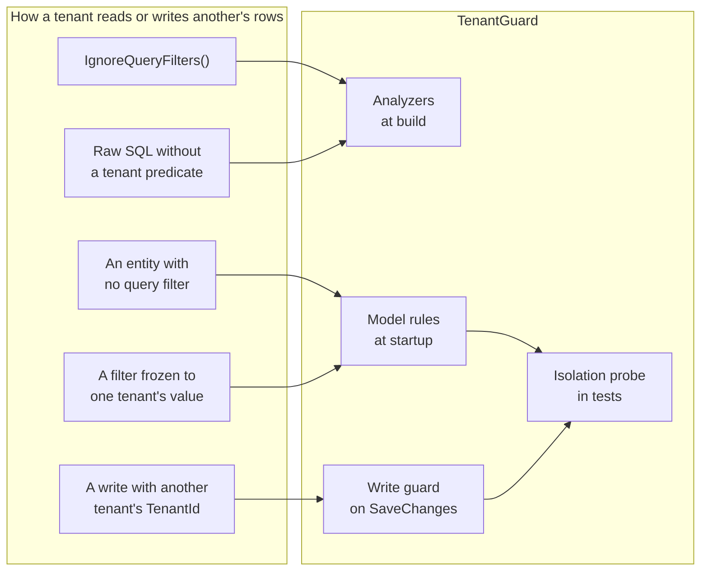

import { Card, CardGrid, LinkCard } from '@astrojs/starlight/components';

## See it in action

One app, four mistakes, and the layer that catches each: the analyzers at build, the model
rules at startup, the write guard on `SaveChanges`, and the isolation probe in tests.

  

    4
    analyzers
    TG001 to TG004, at build
  

  

    8
    model rules
    TGM001 to TGM008, at startup
  

  

    3
    write states guarded
    Added, Modified and Deleted, on SaveChanges
  

  

    6
    probe checks
    per entity, for every pair of tenants, in tests
  

## Where tenant data leaks

Query filters scope what a context reads. Everything below gets around them, and each path
has a layer that stops it.

## What each layer catches

| Leak | At build | At startup | On SaveChanges | In tests |
| --- | --- | --- | --- | --- |
| An entity with a tenant property and no filter | | Yes: TGM001 | | Yes: the probe stops on the rule error |
| A filter that captured a local or a constant | | Yes: TGM003, TGM004 | | Yes, on the rule error |
| `IgnoreQueryFilters()` without a reason | Yes: TG001 | | | |
| Raw SQL that doesn't mention the tenant column | Yes: TG002, or TG004 when it's built at runtime | | | |
| A write, move or delete of another tenant's row | | | Yes: `TenantIsolationViolationException`, before the database | Yes: UpdateGuard, InsertGuard, DeleteGuard |
| A bulk `ExecuteDelete` or `ExecuteUpdate` across tenants | | | Not seen: it skips `SaveChanges` | Yes: BulkIsolation |
| A new entity added months later | | Yes: every rule runs on every entity | Yes, once it's tenant-scoped | Yes: every tenant-scoped entity is probed |

## Why you'd use it

An invoicing app with every tenant in one database starts with a filter on every entity.
A year of ordinary changes later, a new entity ships without one, a support report adds
`IgnoreQueryFilters()`, an import job saves acme's rows as globex's, and a refactor freezes
a filter to the first tenant. None of them fails the build or the tests. With TenantGuard,
each fails at the first moment it can: in the pull request, at startup, or on the first bad
save.

<CardGrid>
  <LinkCard title="Read the use case" description="The four leaks, month by month, and where TenantGuard catches each." href="/guides/use-case/" />
  <LinkCard title="Get started" description="Five lines of registration, with hand-rolled filters or Finbuckle." href="/guides/" />
</CardGrid>

## Four layers

<CardGrid>
  <Card title="At build" icon="seti:c-sharp">
    TG001 to TG004 flag IgnoreQueryFilters() and raw SQL without a tenant predicate, unless the code says why.
  </Card>
  <Card title="At startup" icon="warning">
    TGM001 to TGM008 fail the host when an entity with a tenant property has no query filter, or when the filter is frozen to one value.
  </Card>
  <Card title="On SaveChanges" icon="seti:lock">
    The write guard throws before the database sees a write, move or delete of another tenant's row.
  </Card>
  <Card title="In your tests" icon="approve-check">
    The isolation probe seeds a row per tenant and proves, entity by entity, that one tenant can't reach another's.
  </Card>
</CardGrid>

It works on Finbuckle, on any of the tenancy packages, and on hand-rolled query filters. Install it with `dotnet add package TenantGuard.EntityFrameworkCore --prerelease`.
